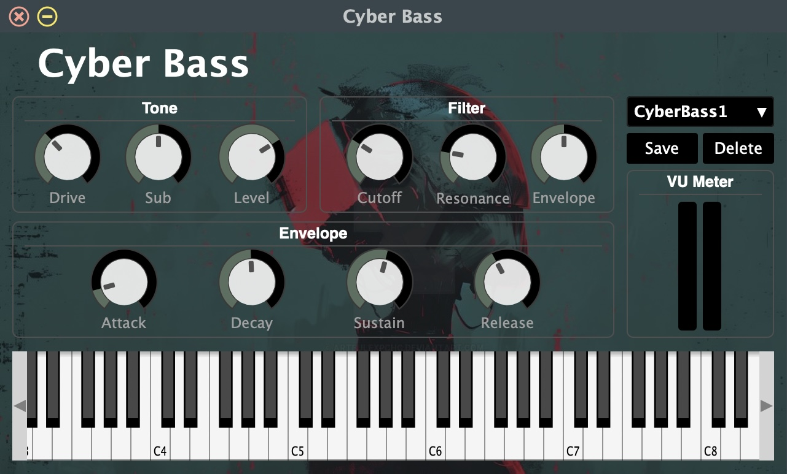
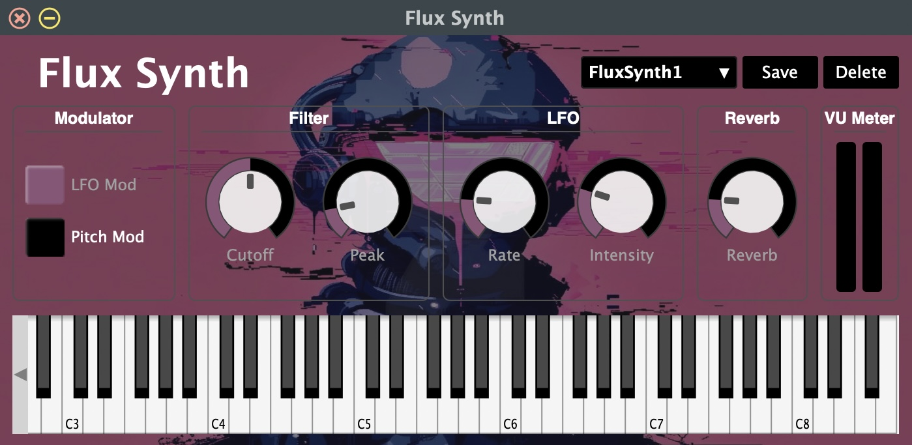
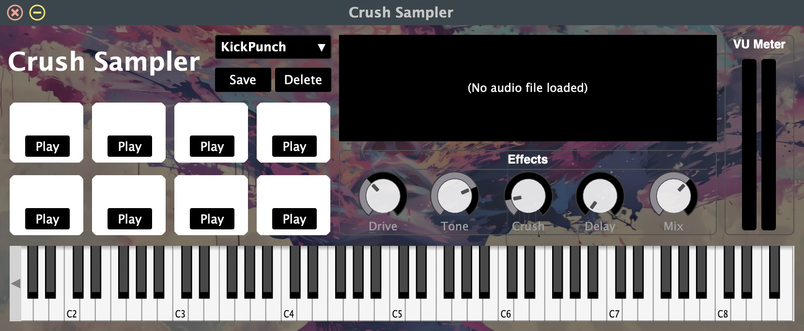
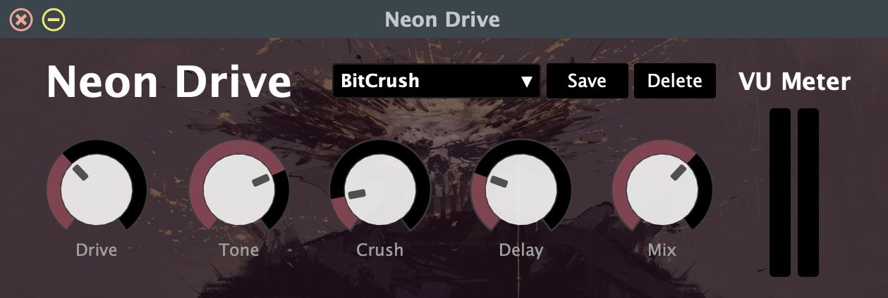
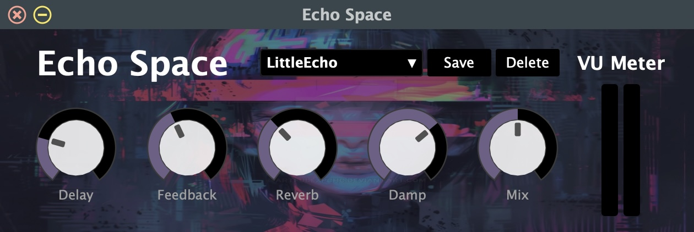

# Cyber Suite

## Description

Cyber Suite is a bundle of five audio plugins developed using Csound and Cabbage. It includes three instruments and two audio effects, offering tools for sound synthesis, sample playback, and audio processing.

The plugins include:

- **Cyber Bass:** A synthesizer for creating and shaping electronic bass sounds.
- **Flux Synth:** A synthesizer that uses modulation and filtering to create evolving electronic sounds.
- **Crush Sampler:** An eight-slot sampler that allows users to load and trigger audio samples.
- **Neon Drive:** A distortion effect that combines drive, filtering, bitcrushing, and delay.
- **Echo Space:** A reverb and delay effect for creating spatial and atmospheric sounds.

## Requirements

Before using the plugins, make sure you have:

- A compatible digital audio workstation (DAW), such as Logic Pro, Ableton Live, or REAPER.
- A macOS system that supports the included AU, VST, or VST3 plugin formats.
- Csound and Cabbage installed if you want to open or modify the original `.csd` files.
  - Cabbage: https://cabbageaudio.com/
  - Csound: https://csound.com/

## Included Plugins

### 1. Cyber Bass

Cyber Bass is a synthesizer designed for creating and shaping electronic bass sounds. It provides controls for drive, sub-bass, filtering, and amplitude envelopes, allowing users to experiment with different combinations of synthesis parameters. It also includes a preset system for saving and recalling different settings.



### 2. Flux Synth

Flux Synth is a synthesizer designed for creating electronic sounds through modulation and filtering. It provides options for switching between LFO and pitch modulation, along with controls for filtering and reverb, allowing users to experiment with different combinations of synthesis parameters. It also includes a preset system for saving and recalling different settings.



### 3. Crush Sampler

Crush Sampler is an eight-slot sampler designed for loading and manipulating audio samples. It provides controls for distortion, filtering, bitcrushing, and delay, allowing users to experiment with different combinations of audio effects. Samples can be triggered using the graphical interface or MIDI notes. It also includes a preset system for saving and recalling different settings.



### 4. Neon Drive

Neon Drive is a distortion effect plugin designed for adding saturation and texture to audio. It provides controls for drive, tone, bitcrushing, delay, and wet/dry mixing, allowing users to experiment with different combinations of distortion and effects. It also includes a preset system for saving and recalling different settings.



### 5. Echo Space

Echo Space is a reverb and delay effect plugin designed for adding space and depth to audio. It provides controls for delay time, feedback, reverb, damping, and wet/dry mixing, allowing users to experiment with different combinations of time-based effects. It also includes a preset system for saving and recalling different settings.



## Installation

Each plugin folder contains a `Plugins/` directory with the exported plugin formats.

### Audio Units (AU) — macOS

1. Open the `Plugins/` folder of the plugin you want to install.
2. Locate the `.component` file.
3. Open Finder and press `Cmd + Shift + G`.
4. Enter the following directory:

   ```text
   ~/Library/Audio/Plug-Ins/Components/
   ```

5. Copy the `.component` file into this folder.
6. Restart your DAW to allow it to scan the plugin.

### VST — macOS

1. Open the `Plugins/` folder of the plugin you want to install.
2. Locate the `.vst` file.
3. Open Finder and press `Cmd + Shift + G`.
4. Enter the following directory:

   ```text
   ~/Library/Audio/Plug-Ins/VST/
   ```

5. Copy the `.vst` file into this folder.
6. Restart your DAW to allow it to scan the plugin.

### VST3 — macOS

1. Open the `Plugins/` folder of the plugin you want to install.
2. Locate the `.vst3` file.
3. Open Finder and press `Cmd + Shift + G`.
4. Enter the following directory:

   ```text
   ~/Library/Audio/Plug-Ins/VST3/
   ```

5. Copy the `.vst3` file into this folder.
6. Restart your DAW to allow it to scan the plugin.

**Note:** Logic Pro uses Audio Units rather than VST or VST3 plugins. The included exports are macOS builds and are not compatible with Windows.

## How to Use

### 1. Cyber Bass

1. Create a software instrument track in your DAW and load Cyber Bass.
2. Play the synthesizer using a MIDI keyboard or MIDI notes.
3. Adjust the drive and sub-bass controls to shape the sound.
4. Use the filter and amplitude envelope controls to further refine the bass.

### 2. Flux Synth

1. Create a software instrument track in your DAW and load Flux Synth.
2. Play the synthesizer using a MIDI keyboard or MIDI notes.
3. Switch between LFO Mod and Pitch Mod to explore different modulation behaviors.
4. Adjust the modulation, filter, and reverb controls to shape the sound.

### 3. Crush Sampler

1. Create a software instrument track in your DAW and load Crush Sampler.
2. Load audio samples into the eight available slots.
3. Trigger samples using the graphical interface or MIDI notes.
4. Adjust the distortion, filter, bitcrushing, and delay controls to process the samples.

### 4. Neon Drive

1. Insert Neon Drive as an audio effect on an audio or software instrument track.
2. Adjust the drive, tone, bitcrushing, and delay controls to shape the incoming audio.
3. Use the Mix control to blend the processed signal with the original audio.

### 5. Echo Space

1. Insert Echo Space as an audio effect on an audio or software instrument track.
2. Adjust the delay time, feedback, reverb, and damping controls to create different spatial effects.
3. Use the Mix control to blend the processed signal with the original audio.

## Presets

Each plugin includes a built-in preset system that allows users to create and manage their own sounds and effect settings directly within their DAW.

- **Load:** Select a previously saved preset from the dropdown menu.
- **Save:** Save the current settings as a new preset.
- **Delete:** Remove a selected preset.

## Source Code

All five plugins were developed using Csound for audio synthesis and processing, and Cabbage for graphical interface design and plugin integration.

To open or modify a plugin:

1. Install Csound and Cabbage.
2. Open the corresponding `.csd` file in Cabbage.
3. Keep the associated `.jpg` interface image and `.snaps` preset file in the same folder as the `.csd` file.
4. Run the plugin in Cabbage to test or modify its functionality.